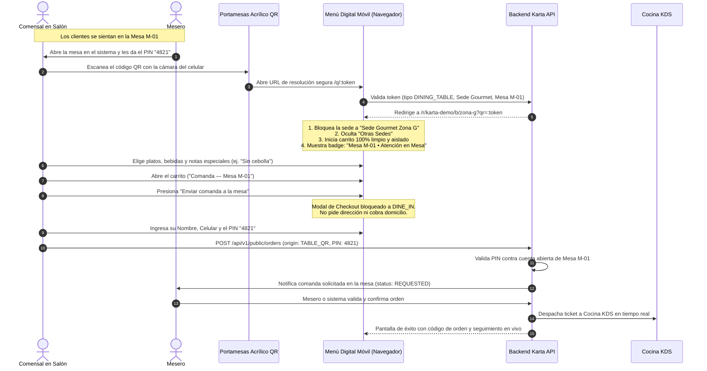
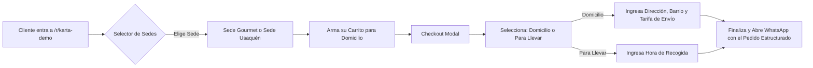

# Guía del Comensal: Autopedido QR en Mesa Física vs Menú Digital para Domicilios

**Documento:** `MANUAL_CLIENTE_AUTOPEDIDO_QR_Y_EXPERIENCIA_MESA.md`  
**Rol del Usuario:** Cliente / Comensal en Salón / Usuario Externo  
**Módulos del Sistema:** `public-storefront` (Vitrina Pública y Carta Digital), `ordering` (Motor de Pedidos)  
**Versión:** 2.4.0 — Plataforma SaaS Gastronómica Karta  
**Fecha:** 29 de Octubre de 2026  

---

## 1. Dos Modos de Experiencia: ¿Mesa Física o Pedido a Domicilio?

En Karta, el menú digital se adapta de forma inteligente e inmediata según el canal de acceso del cliente:

| Modalidad | Modo 1: 🍽️ Autopedido en Mesa Física (Salón) | Modo 2: 🛵 Pedido Público (Domicilio / Para Llevar) |
|---|---|---|
| **Punto de Entrada** | Escaneo del código QR en el portamesas acrílico de la mesa. | Enlace web del restaurante (ej. `karta.co/r/karta-demo`). |
| **Ubicación del Cliente** | Físicamente sentado en una mesa del restaurante. | En su casa, oficina o desde cualquier lugar remoto. |
| **Sucursal del Menú** | **BLOQUEADA** a la sede donde está ubicada la mesa física. | **LIBRE**: El cliente puede elegir la sede más cercana. |
| **Selector "Otras Sedes"** | **OCULTO** (evita perder la asignación de la mesa). | **VISIBLE** (`Otras Sedes: [Sede Gourmet] [Sede Usaquén]`). |
| **Aislamiento del Carrito** | Carrito exclusivo de la mesa (`table-:tableId`). | Carrito de despacho a domicilio (`/takeout`). |
| **Modalidad en Checkout** | **BLOQUEADA A `DINE_IN`** (Comanda de Mesa). | Selección entre **Domicilio** y **Para Llevar**. |
| **Requisito de Seguridad** | **PIN de Mesa de 4 dígitos** (brindado por el mesero). | Validación telefónica y zona de cobertura. |
| **Destino del Pedido** | Comanda cargada a la cuenta de mesa $\rightarrow$ Cocina KDS. | Despacho a domicilio $\rightarrow$ Confirmación por WhatsApp. |

---

## 2. Flujo Completo del Comensal en Mesa Física



---

### Paso 1: El Portamesas Físico en la Mesa

Cada mesa del restaurante cuenta con un soporte físico acrílico (10x15 cm) que contiene:
- El nombre y logotipo de la marca gastronómica.
- El nombre del ambiente (ej. *Salón Principal* o *Terraza*).
- El número grande de mesa claramente visible (ej. **Mesa M-01**).
- El **Código QR vectorial de alta definición**.
- Una indicación instructiva: *"Escanea con tu celular para ver la carta y pedir. Tu mesero te dará el PIN de 4 dígitos al sentarte"*.

---

### Paso 2: Escaneo y Resolución Transparente

1. El comensal abre la cámara de su teléfono inteligente (iOS o Android) y enfoca el código QR.
2. La cámara detecta el enlace seguro del sistema: `https://karta.co/q/7d0adb985638...`
3. Al tocar el enlace:
   - El resolver interno ([`QrResolverPage.tsx`](file:///c:/AcaSoft/aca-restaurant-saas/apps/web/src/features/public-storefront/QrResolverPage.tsx)) identifica instantáneamente que el código corresponde a la **Mesa M-01** de la **Sede Gourmet Zona G**.
   - Redirige de forma transparente al menú digital:  
     `/r/karta-demo/b/zona-g?qr=7d0adb985638...`

---

### Paso 3: Bloqueo de Sede y Protección de Mesa

Para evitar que el cliente pierda la asignación física de su mesa:
- **Selector de Sedes Oculto:** El selector `"Otras Sedes:"` desaparece de la vista. El cliente no puede saltar por error a otra sede distante.
- **Badge Institucional de Salón:** En el encabezado del menú se despliega un distintivo destacado:
  `🍽️ Mesa M-01 • Sede Gourmet Zona G [Atención en Mesa]`
- **Menú Sincronizado:** La carta, categorías, disponibilidad y precios que se muestran son los configurados exactamente para esa sucursal física.

---

### Paso 4: Aislamiento Total del Carrito (Cero Contaminación)

Uno de los problemas más delicados en sistemas de autopedido ocurre cuando un comensal visita el restaurante y en su carrito aparecen pizzas o productos que había cotizado semanas atrás para domicilio desde su casa.

En Karta, el carrito de la mesa utiliza una **clave de almacenamiento única y aislada** ([`StorefrontPage.tsx`](file:///c:/AcaSoft/aca-restaurant-saas/apps/web/src/features/public-storefront/StorefrontPage.tsx#L100-L108)):
```typescript
storeKey = `${restaurantSlug}/${branchSlug}/table-${tableId}`;
```
**Garantía para el Comensal:**
- La cesta de compra **inicia siempre 100 % limpia y vacía**.
- Jamás se mezclan productos de pedidos para llevar o domicilios anteriores.
- Si en la misma mesa hay varios teléfonos escaneando el QR, cada cliente puede explorar libremente o usar el botón `"Vaciar carrito"` para reiniciar su selección si lo desea.

---

### Paso 5: Exploración del Menú y Personalización de Platos

1. El comensal navega por las categorías (Entradas, Fuertes, Cócteles, Postres).
2. Cada plato incluye:
   - Fotografía en alta resolución.
   - Descripción detallada de ingredientes y alérgenos (gluten, lácteos, frutos secos, etc.).
   - Precio en Pesos Colombianos (COP) con aviso legal DIAN sobre documento informativo.
3. Al hacer clic en un plato ([`ProductModal.tsx`](file:///c:/AcaSoft/aca-restaurant-saas/apps/web/src/features/public-storefront/ProductModal.tsx)):
   - Selecciona opciones o variantes (ej. *Término de la carne, término medio o tres cuartos*).
   - Marca adiciones deseadas (ej. *Tocineta caramelizada, queso azul extra*).
   - Agrega comentarios específicos (ej. *"Por favor la salsa tártara aparte"*).
4. Pulsa **"Agregar al pedido"**.

---

### Paso 6: Checkout en Mesa y el PIN de Seguridad

1. En la parte inferior de la pantalla aparece la barra flotante con el total en COP.
2. Al pulsar **"Ver mi pedido"**, se despliega el cajón lateral:
   - Encabezado: **`Comanda — Mesa M-01`**.
   - Desglose detallado de ítems y valores.
   - Botón de acción destacado: **`Enviar comanda a la mesa`**.
3. Al tocar el botón, se abre el modal de checkout especializado para salón ([`CheckoutModal.tsx`](file:///c:/AcaSoft/aca-restaurant-saas/apps/web/src/features/public-storefront/CheckoutModal.tsx#L317-L380)):
   - **Modalidad fija:** `Comanda en Mesa Física • Mesa M-01` (no existen opciones de envío a domicilio).
   - **Datos requeridos:**
     - Nombre o referencia (ej. *"Carlos"*).
     - Teléfono WhatsApp de contacto.
     - **PIN de Mesa de 4 dígitos:** Campo de seguridad donde el comensal teclea el PIN proporcionado por su mesero (ej. `4821`).
   - **Sin campos irrelevantes:** No se solicitan direcciones, barrios ni se cobran tarifas de transporte.
4. El comensal acepta la política de tratamiento de datos (Ley 1581 de 2012) y pulsa **"Enviar Comanda a Cocina y Mesero"**.

---

### Paso 7: Despacho a Cocina y Seguimiento en Vivo

1. El sistema valida el PIN contra la cuenta activa de la mesa:
   - Si el PIN es correcto, la comanda queda registrada exitosamente.
   - El sistema emite la orden directamente al mesero y al KDS de cocina.
2. La pantalla del comensal muestra la confirmación:
   - **Código de Comanda:** (Ej. `#M01-03`).
   - Botón interactivo: **"Ver Estado en Vivo de tu Comanda"**.
3. El cliente puede consultar en tiempo real si su plato está *En Preparación*, *Listo en Cocina* o *Servido en Mesa*.
4. Al terminar su estancia, el comensal simplemente solicita la cuenta física a su mesero y realiza el pago en efectivo o datafono.

---

## 3. ¿Cómo Funciona cuando el Cliente Pide para Domicilio desde su Casa?

Si un cliente no está en el restaurante y accede al menú general (por ejemplo, desde un enlace en Instagram o WhatsApp a `karta.co/r/karta-demo`):



1. **Selector de Sedes Disponible:** El cliente visualiza `"Otras Sedes:"` y puede cambiar libremente entre *Sede Gourmet Zona G* o *Sede Usaquén*.
2. **Carrito de Takeout Separado:** Su carrito se guarda bajo `karta-demo/:sede/takeout`, completamente independiente de cualquier mesa física.
3. **Modalidades Disponibles:** En el checkout puede elegir entre **`[ 🚚 Domicilio ]`** o **`[ 🛍️ Para Llevar ]`**. La opción *En Mesa* no aparece.
4. **Zonas y Fletes:** Selecciona su zona de cobertura barrial, se calcula el flete de domicilio automáticamente y se verifica si cumple con el pedido mínimo.
5. **Cierre por WhatsApp:** Al confirmar, el sistema genera el pedido y le ofrece un botón verde para abrir WhatsApp con el mensaje pre-estructurado y coordinar la entrega o pago contra entrega.

---

## 4. Preguntas Frecuentes del Comensal

### ¿Por qué el sistema me pide un PIN de 4 dígitos al ordenar en la mesa?
El PIN es una medida de seguridad antifraude que protege tu mesa. Garantiza que solo las personas que están verdaderamente sentadas en la mesa física puedan ordenar platos. Evita que terceros que hayan guardado el enlace o fotografiado el QR desde la calle hagan pedidos falsos a tu cuenta.

### ¿Dónde obtengo el PIN de mi mesa?
Tu mesero te entregará el PIN verbalmente cuando te dé la bienvenida y abra la mesa en el sistema, o puedes solicitárselo en cualquier momento.

### ¿Podemos pedir varias personas desde celulares distintos en la misma mesa?
¡Sí! Todas las personas sentadas en la misma mesa pueden escanear el mismo código QR del portamesas. Cada quien elige lo que desea en su celular, ingresa el mismo PIN de la mesa y las comandas se sumarán organizadamente a la cuenta compartida de la mesa.

### ¿Qué pasa si me equivoco al ingresar el PIN?
El sistema te mostrará una alerta indicando que el PIN es incorrecto. Puedes verificar el número con tu mesero e ingresarlo nuevamente sin perder los platos que ya tienes en el carrito.

