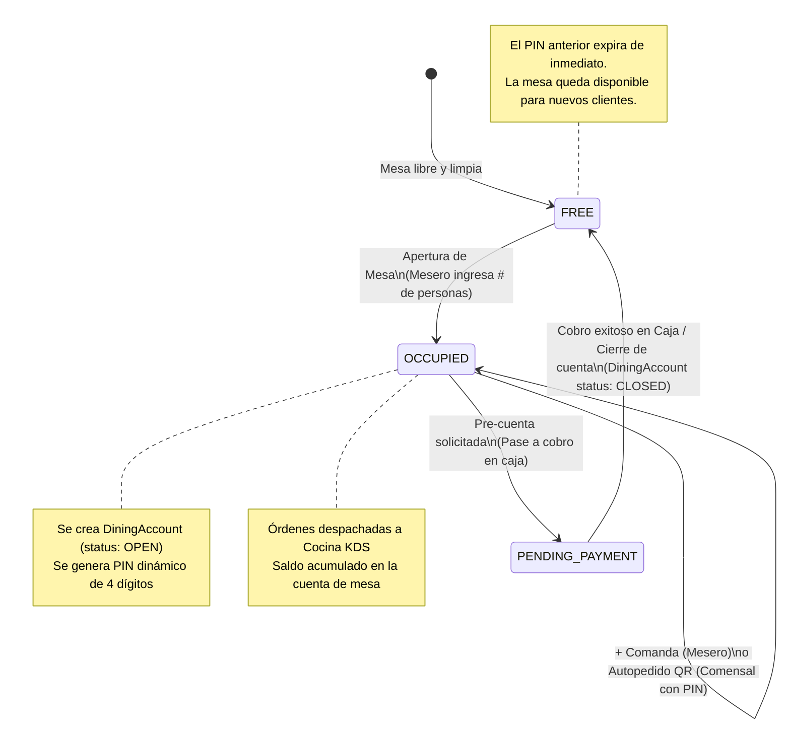
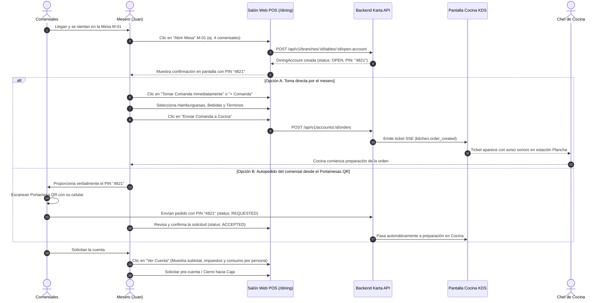

# Guía Operativa: Manejo de Salón, Mesas y Toma de Comandas (Rol de Mesero)

**Documento:** `MANUAL_OPERATIVO_MESERO_SALON_Y_COMANDAS.md`  
**Rol Operativo:** `WAITER` (Mesero / Garzón / Capitán de Salón)  
**Módulos del Sistema:** `dining` (Salón & Mesas), `catalog` (Menú de Productos), `kitchen` (KDS de Cocina)  
**Versión:** 2.4.0 — Plataforma SaaS Gastronómica Karta  
**Fecha:** 29 de Octubre de 2026  

---

## 1. Filosofía Operativa del Rol de Mesero en Karta

El rol **Mesero (`WAITER`)** está diseñado exclusivamente para la **operación ágil en el salón físico**. Para proteger la integridad del restaurante y evitar costosos errores durante las horas pico de servicio:

1. **Aislamiento Rígido por Sucursal:** Un mesero asignado a la *Sede Gourmet Zona G* solo visualiza y opera las mesas de esa sucursal física. No tiene acceso a sedes ajenas ni puede alternar sucursales.
2. **Protección de Navegación e Interfaz Blindada:**
   - La barra de navegación lateral del mesero está simplificada al máximo: contiene únicamente **Salón y Mesas (`/dining`)**.
   - No tiene acceso a la edición de cartas o precios (`/menu`), panel de control SaaS (`/admin/*`) ni métricas gerenciales (`/reports` o `/dashboard`). La carta ya viene configurada por la administración.
   - Cualquier intento de acceder por URL directa a rutas administrativas es interceptado y redirigido automáticamente a `/dining`.
3. **Comandas Directas sin Fricción:** El mesero no requiere ingresar PIN de mesa para agregar productos, ya que se encuentra autenticado con sus credenciales institucionales seguras.

---

## 2. Mapa y Ciclo de Vida de los Estados de Mesa

En el plano interactivo de salón ([`DiningFloorPlanPage.tsx`](file:///c:/AcaSoft/aca-restaurant-saas/apps/web/src/features/dining-pos/DiningFloorPlanPage.tsx)), cada mesa transita por los siguientes estados:

| Estado Visual | Color de Identificación | Significado Operativo | Acciones Permitidas para el Mesero |
|---|---|---|---|
| **`FREE`** | Verde esmeralda | Mesa limpia, disponible para sentar clientes. | **"Abrir Mesa"** (asigna comensales y genera PIN). |
| **`OCCUPIED`** | Naranja cálido | Mesa con clientes activos y cuenta abierta. | **`+ Comanda`** (toma de pedidos), ver detalle de cuenta, consultar PIN, traslado. |
| **`PENDING_PAYMENT`** | Violeta suave | Pre-cuenta impresa; clientes en proceso de pago. | Ver resumen de consumos, distribución por persona. Cobro finalizado en caja. |
| **`RESERVED`** | Azul cielo | Mesa reservada para horario específico. | Ocupar mesa cuando llegue la reserva o liberar. |

---

## 3. Flujo Paso a Paso: Operación en Salón

---

### Paso 1: Apertura de la Mesa Física

1. En el plano de salón (`/dining`), localiza la tarjeta de la mesa deseada (ej. **Mesa M-01** con borde verde `FREE`).
2. Haz clic en el botón verde **"Abrir Mesa"**.
3. Se despliega el modal interactivo de apertura:
   - **Número de Comensales:** Ingresa la cantidad real de personas sentadas (ej. `4`). Esto alimenta los reportes de ocupación y rotación.
   - **Notas iniciales (Opcional):** Ejemplo: *"Celebración de cumpleaños"* o *"Ubicados junto a la ventana"*.
4. Presiona **"Confirmar y Abrir Mesa"**.
5. **Resultado Inmediato:**
   - La mesa cambia a color naranja **`OCCUPIED`**.
   - El sistema genera un **PIN dinámico de 4 dígitos** (ej. `4821`).
   - La ventana de éxito te presenta dos caminos:
     - Botón naranja **`Tomar Comanda Inmediatamente`**: Te lleva directo a la carta para ordenar.
     - Botón blanco **`Volver al Salón`**: Deja la mesa lista para que los comensales pidan por su cuenta con el QR físico.

---

### Paso 2: Toma de Comandas desde la Mesa (`+ Comanda`)

El mesero puede añadir nuevos pedidos a la mesa tantas veces como los clientes deseen durante su estancia:

1. En la tarjeta de la mesa ocupada, pulsa el botón naranja **`+ Comanda`** (o toca la mesa directamente).
2. Se abre el catálogo visual optimizado para tablets y pantallas táctiles ([`WaiterOrderModal.tsx`](file:///c:/AcaSoft/aca-restaurant-saas/apps/web/src/features/dining-pos/WaiterOrderModal.tsx)):
   - **Filtro por Categorías:** Entradas, Fuertes, Bebidas, Postres, etc.
   - **Buscador en Tiempo Real:** Teclea las primeras letras del plato para ubicarlo al instante.
3. **Selección del Plato:**
   - Si el producto tiene variantes (ej. *Tamaño Personal vs Familiar*), selecciona la deseada.
   - Si tiene modificaciones (ej. *Queso extra, tocineta*), márcalas en pantalla.
   - **Instrucciones de Cocina:** Añade notas textuales directas para el chef (ej. *"Término 3/4", "Salsa tártara aparte", "Sin cebolla"*).
4. **Resumen y Envío:**
   - En la columna derecha visualizas la comanda en borrador con el subtotal acumulado.
   - Presiona el botón verde **"Enviar Comanda a Cocina"**.
5. **Impacto en el Sistema:**
   - La orden se registra con `origin = 'POS_WAITER'` y `payment_status = 'UNPAID'`.
   - Se despacha de forma atómica a las estaciones de cocina correspondientes en el KDS vía Server-Sent Events (SSE).
   - El saldo pendiente de la mesa (`uncollected_amount_cop`) se actualiza automáticamente.

---

### Paso 3: ¿Para qué se usa el PIN de Mesa y cómo entregarlo al Comensal?

> [!IMPORTANT]
> **El PIN de 4 dígitos NO es necesario para el mesero.** El mesero toma comandas directamente sin clave.

El PIN se utiliza **exclusivamente para proteger a los comensales cuando piden desde su propio teléfono** escaneando el código QR del portamesas físico:
1. **Evita pedidos fantasma:** Impide que personas que no están físicamente en el restaurante (o clientes de mesas vecinas) envíen platos a esa mesa.
2. **Entrega Verbal:** Cuando los clientes manifiestan que desean pedir desde el celular, el mesero les indica: *"El código PIN de su mesa es el **4821**"*.
3. **Consulta Visual:** El mesero siempre puede consultar el PIN activo haciendo clic sobre la mesa en su pantalla de salón.
4. **Vigencia:** El PIN permanece activo mientras la mesa esté abierta. En el momento en que la mesa paga la cuenta y se cierra, el PIN queda destruido e invalidado. La siguiente mesa recibirá un PIN totalmente distinto.

---

### Paso 4: Consulta de Pre-Cuenta y División Informativa por Persona

Cuando los clientes terminan de consumir y desean saber el importe a pagar o dividir la cuenta:

1. Toca la mesa ocupada y presiona **"Ver Cuenta de Salón"**.
2. Visualizarás la pre-cuenta completa:
   - Desglose de cada comanda despachada, hora de envío y mesero que la tomó.
   - Total bruto, impuestos aplicados (impoconsumo o IVA) y total consolidado en pesos colombianos (COP).
   - Aviso informativo legal DIAN (*"Documento informativo / pre-cuenta de control interno"*).
3. **División Informativa por Comensal (`consumption_split`):**
   - Si los 4 clientes desean pagar por separado (ej. *"¿Cuánto le toca a cada uno?"*):
   - El mesero puede usar la herramienta de distribución para asignar ítems específicos a cada persona (*Persona 1: Hamburguesa; Persona 2: Ensalada y jugo*).
   - El sistema calcula el valor exacto de cada uno conciliado al peso (`1 COP`), sin alterar el saldo total central de la mesa.

---

### Paso 5: Solicitud de Cierre y Cobro en Caja

1. Una vez los comensales confirman su método de pago (Efectivo, Tarjeta Débito/Crédito, Transferencia Nequi/Daviplata):
2. La mesa pasa al estado **`PENDING_PAYMENT`**.
3. El mesero dirige la cuenta a la estación del **Cajero (`CASHIER`)**, quien registra el cobro en el módulo de pagos.
4. Una vez liquidada la cuenta:
   - La `DiningAccount` cambia a `CLOSED`.
   - La mesa física vuelve a **`FREE`** (disponible para el siguiente servicio).

---

## 4. Reglas de Negocio y Preguntas Frecuentes del Mesero

### ¿Qué ocurre si un cliente se cambia de mesa?
El mesero utiliza la opción **"Mover Mesa"** en el panel de acciones. Selecciona la nueva mesa de destino (que debe estar en estado `FREE`). El sistema traslada la cuenta completa, los pedidos pendientes y el PIN a la nueva ubicación física sin perder ningún ítem.

### ¿Puede un mesero anular un plato ya enviado a cocina?
Si un plato ya fue despachado al KDS, el mesero debe coordinar con el jefe de cocina o gerente (`BRANCH_MANAGER`) para cancelar el ítem en la pantalla KDS (`kitchen`), registrando el motivo de desperdicio o error.

### ¿Qué sucede si dos meseros toman comandas en la misma mesa al mismo tiempo?
Karta utiliza **control de concurrencia optimista** mediante el campo `version` de la cuenta. Si ocurre una colisión simultánea, el sistema guarda la primera orden y notifica al segundo mesero para refrescar la pantalla sin sobrescribir ni duplicar productos.

